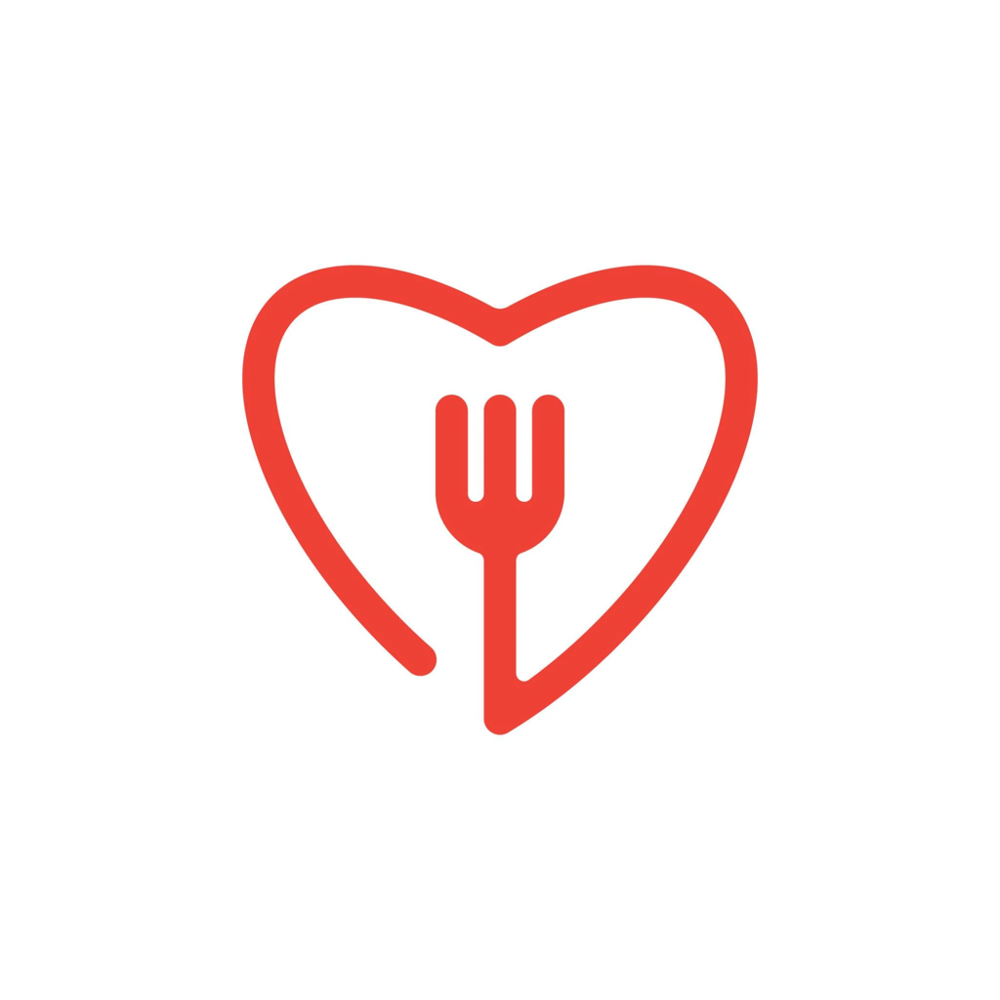

<p align="center"></p>

# Crave

A group of friends can't agree on where to eat. Everyone swipes yes or no on nearby restaurants, and the app shows a match when the whole group likes the same place.

## Who owns what

| Area | Owner | Folder |
| --- | --- | --- |
| Front end: screens, swipes, animations, design | Davin | [`frontend/`](frontend/) |
| Back end: groups, restaurant data, swipes, match logic, live updates, hosting | Colby | [`backend/`](backend/) |
| API contract: endpoints, field names, events, errors | Both | [`docs/API.md`](docs/API.md) |

The full task split is in [`TASKS.md`](TASKS.md).

## Project layout

```
crave/
├── README.md          this file
├── TASKS.md           frontend vs backend tasks, week by week
├── assets/logo/       the Crave logo (placeholder for now)
├── docs/
│   ├── API.md         the contract both sides build against
│   └── mock/          fake responses Davin can use before the back end is ready
├── frontend/          Davin's code
└── backend/           Colby's code
```

## Brand (for now)

| Item | Value |
| --- | --- |
| Name | Crave |
| Logo | [`assets/logo/`](assets/logo/): heart with a fork, line style |
| Primary color | `#EE4135` (the logo red) |
| Background | `#FFFFFF` |

The logo is a placeholder. Davin's style guide can build on it or replace it.

## How it works

1. One person starts a group and picks a location and filters (distance, price, type of food).
2. They share a short code or link with friends.
3. Everyone joins and sees the same stack of restaurant cards.
4. Each person swipes right (yes) or left (no) on their own phone.
5. As soon as everyone says yes to the same place, all phones show a match screen.
6. The match screen has the address, hours, and a button to open directions.

## First version vs. later

The first version only needs to do one thing well: get a group to a match.

| First version | Later |
| --- | --- |
| Join with a code, nickname only | Real accounts and saved friend groups |
| Location, distance, price filters | Diet filters (vegan, halal, gluten-free) |
| Swipe yes or no | "Super like" or ranked picks |
| Match when everyone says yes | Show the top 3 if nobody fully matches |
| Address and directions on match | Reservations, past matches, sharing |

## Working together (GitHub, to set up later)

- One repo, this folder as the root. Each person works mostly in their own folder.
- Work on a branch, open a pull request, the other person glances at it, then merge to `main`.
- Changes to `docs/API.md` need both of you to agree before merging, since you both depend on it.
- Never commit API keys. They live in `backend/.env`, which is git-ignored.
